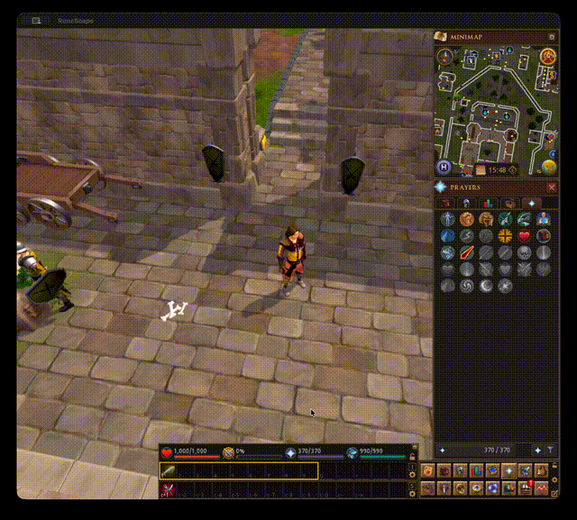
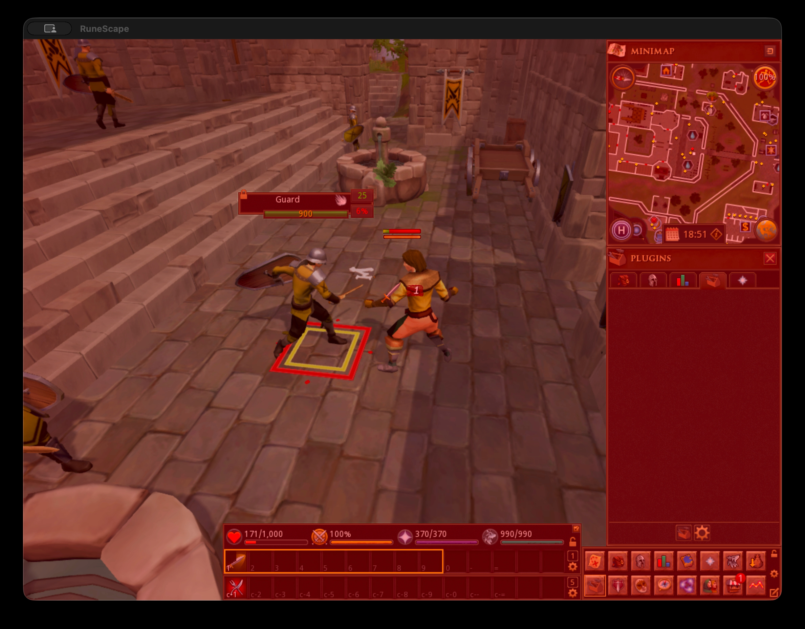
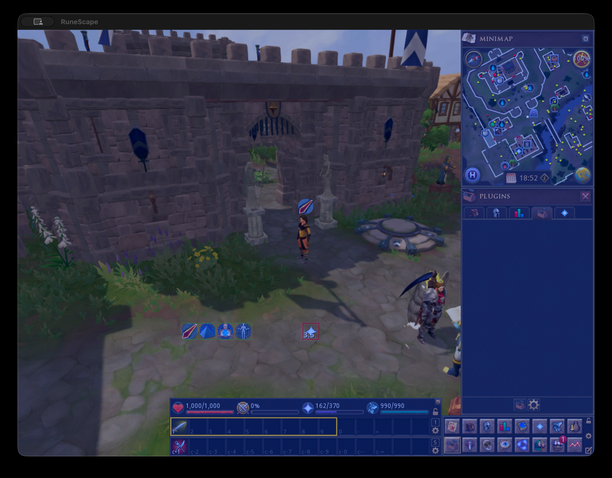
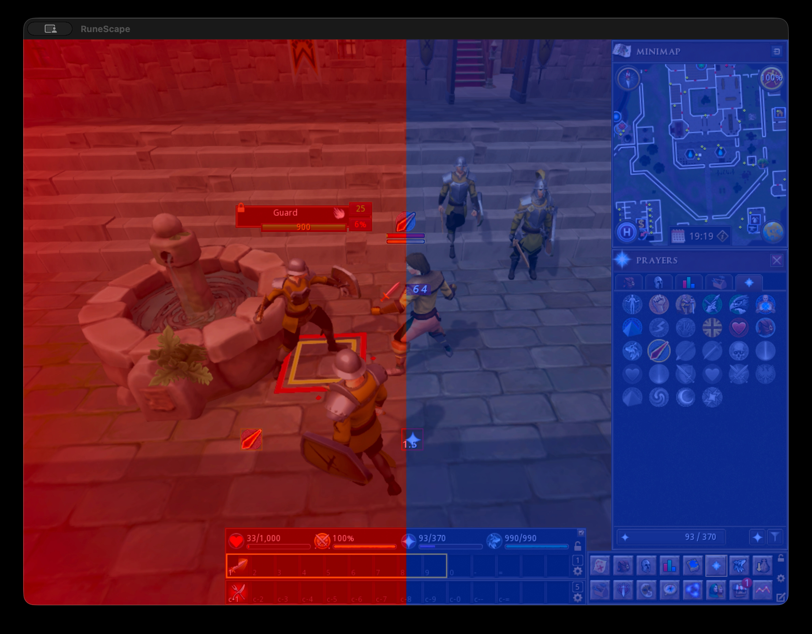
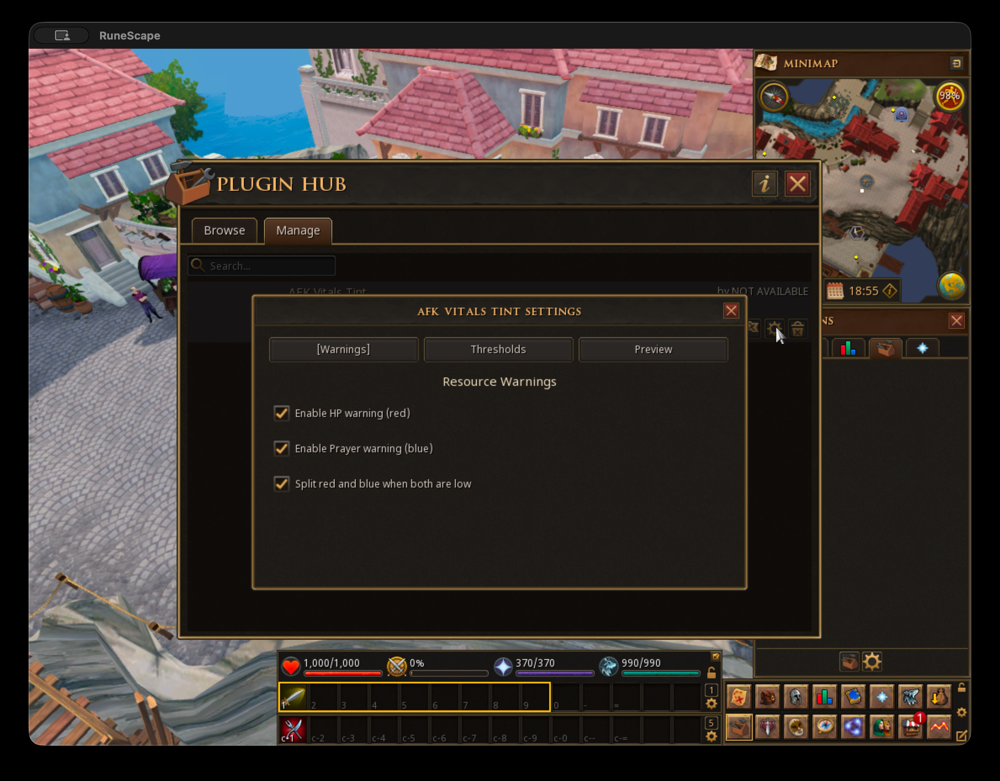
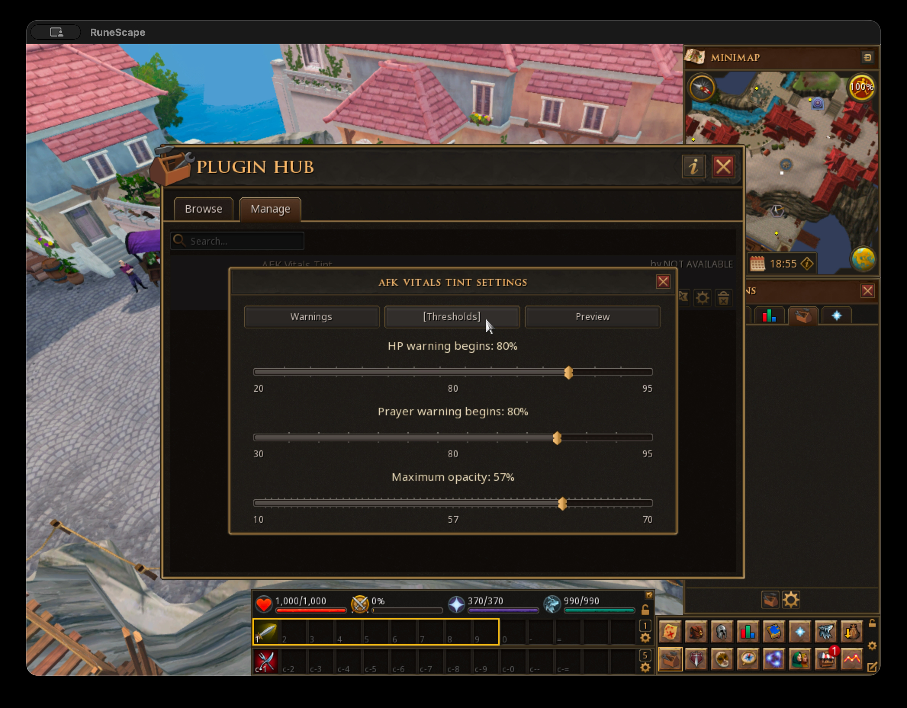
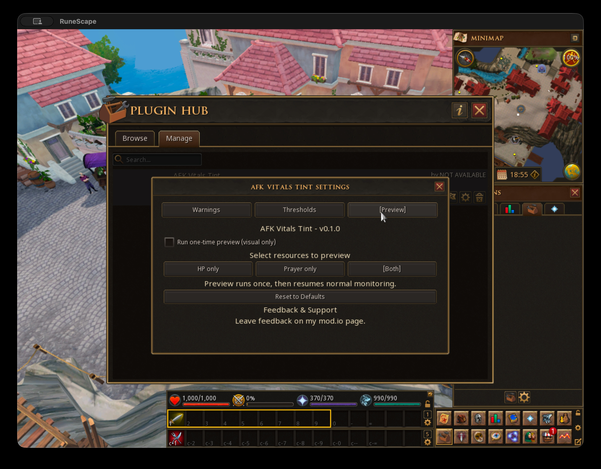

# RS3-Plugin-AFK-Vitals-Tint


<div align="center">

# AFK Vitals Tint

### A visual Health & Prayer warning plugin for RuneScape 3

**Know when your resources are running low without constantly watching the bars and enjoy more combat AFKing.**

[](https://github.com/JohnMichaelCrawley/RS3-Plugin-AFK-Vitals-Tint/blob/master/src/plugin.json)


[Features](#-features) · [Screenshots](#-screenshots) · [Installation](#-installation) · [Settings](#%EF%B8%8F-settings) · [Development](#-development) · [mod.io](#-modio-release)

</div>

---

## Demo (Both HP and Prayer turned on)



*Demo: warning colours intensify as resources fall.*

## Features

- **Low HP warning:** a transparent red screen tint appears as your Life Points fall below your chosen threshold.
- **Low Prayer warning:** a transparent blue tint increases in intensity as your Prayer Points decrease.
- **Split-screen warnings:** when both resources are low, red occupies the left half and blue the right half (enabled by default).
- **Custom thresholds and opacity:** choose when warnings start and how prominent the overlays become.
- **Click-through overlays:** keep interacting with RuneScape while the tint is visible.
- **Saved preferences:** warning toggles, thresholds, split mode and maximum opacity persist between sessions.
- **One-time visual preview:** test HP, Prayer or both without changing in-game resource values.
- **Prayer-reading stabilisation:** handles temporary missing readings and filters sudden inconsistent increases to reduce flashing.

## Screenshots
<table>
  <tr>
    <td width="50%" align="center">
      
      <br /><strong>Low HP — red tint</strong>
    </td>
    <td width="50%" align="center">
      
      <br /><strong>Low Prayer — blue tint</strong>
    </td>
  </tr>
  <tr>
    <td width="50%" align="center">
      
      <br /><strong>Both low — Split-screen mode</strong>
    </td>
    <td width="50%" align="center">
      
      <br /><strong>Settings — Warnings</strong>
    </td>
  </tr>
  <tr>
    <td width="50%" align="center">
      
      <br /><strong>Settings — Thresholds</strong>
    </td>
    <td width="50%" align="center">
      
      <br /><strong>Settings — Preview</strong>
    </td>
  </tr>
</table>

## ⚙️ Settings

Open the plugin's **settings cog** in the RuneScape Plugin Hub.

Version `0.1.0` provides three settings tabs:

| Tab | Controls |
| --- | --- |
| **Warnings** | Enable/disable HP warning, enable/disable Prayer warning, enable/disable split-screen mode |
| **Thresholds** | HP warning start, Prayer warning start, maximum overlay opacity |
| **Preview** | Run a one-time visual preview for HP, Prayer or both; view plugin version and feedback details |

### Default values (v0.1.0)

| Setting | Default | Adjustment range |
| --- | --- | --- |
| HP warning | Enabled | On / Off |
| Prayer warning | Enabled | On / Off |
| Split when both low | Enabled | On / Off |
| HP warning starts | Below 70% HP | 20–95% (5% increments) |
| Prayer warning starts | Below 70% Prayer | 30–95% (5% increments) |
| Maximum opacity | 52% | 10–70% (1% increments) |
| Full-strength Prayer tint | At 20% Prayer | Configured in `src/settings.lua` |

The colour intensity increases as the resource level falls.

The HP and Prayer warnings use their own intensity calculations. In split-screen mode, red is displayed on the **left** and blue on the **right**.

Saved settings are restored on reload. **Preview does not persist** and automatically stops after its run.

## Installation

### Mod.io (waiting approval)
> ⏳ **Awaiting moderation.** This plugin was submitted to mod.io, but its public listing is not confirmed yet. Until approved, it is not available to install on live RuneScape worlds.

Once approved:

1. Launch **RuneScape 3** and open the **Plugin Hub** from the in-game Plugins interface.
2. Search for **AFK Vitals Tint**.
3. Select **Install**, then enable the plugin under **Manage** if needed.
4. Select the **settings cog** to customise HP/Prayer warnings.

[Browse RuneScape plugins on mod.io](https://mod.io/g/runescape)

## 🧪 Testing and CI/CD

The Jenkins pipeline under `.jenkins/Jenkinsfile` performs:

1. **Source checkout** and required-file verification.
2. **Lua syntax checks** for source and tests.
3. **Manifest JSON validation** and unit tests of warning/Prayer logic.
4. **Release packaging** and ZIP integrity checks.
5. **Optional Developer Beta deployment**, when explicitly enabled.
6. **Optional mod.io submission**, gated by branch restrictions, release details, credentials and manual approval.


## Project structure

```text
RS3-Plugin-AFK-Vitals-Tint/
├── .jenkins/
│   ├── Jenkinsfile              # Defines the Jenkins CI/CD pipeline and build stages
│   └── scripts/
│       ├── ci.sh                # Validates Lua syntax, plugin manifest and runs automated tests
│       ├── package.sh           # Packages plugin files into a distributable ZIP archive
│       ├── deploy-rc.sh         # Deploys the plugin to RuneScape Developer Beta for testing
│       └── deploy-modio.sh      # Handles mod.io release submission and deployment
├── assets/
│   ├── demo.gif                 # Animated gameplay demonstration of HP and Prayer warnings
│   └── screenshots/
│       ├── hp-warning.jpg       # Red screen tint when HP falls below the warning threshold
│       ├── prayer-warning.jpg   # Blue screen tint when Prayer falls below the warning threshold
│       ├── split-warning.jpg    # Split-screen display when both HP and Prayer are low
│       ├── settings-warnings.jpg   # Settings for enabling HP, Prayer and split-screen warnings
│       ├── settings-thresholds.jpg # Configurable warning thresholds and overlay opacity
│       └── settings-preview.jpg    # Settings for previewing visual warnings
├── dist/                        # Generated plugin release packages
├── src/
│   ├── main.lua                 # Runtime monitoring and overlay rendering
│   ├── logic.lua                # HP/Prayer calculations and reading stabilisation
│   ├── settings.lua             # Default configuration and persistent preferences
│   ├── settings_ui.lua          # In-game settings interface and preview functionality
│   └── plugin.json              # Plugin metadata, manifest and version
├── tests/
│   └── test_logic.lua           # Automated unit tests for warning calculations
├── .gitignore                   # Excludes generated files and local development artifacts
└── README.md                    # Project documentation, installation and usage
```


## 🚀 mod.io release

| Field | Value |
| --- | --- |
| Plugin | **AFK Vitals Tint** |
| Current manifest version | **0.1.0** |
| Submission | Submitted for moderation |
| Public listing | Pending / URL to be added |

## 📝 Changelog

### v0.1.0 — Current development version

- Added red HP and blue Prayer warning overlays.
- Added optional split-screen display when both resources are low.
- Added configurable warning thresholds and overlay opacity.
- Added persistent in-game settings and a one-time preview.
- Added Prayer-reading stabilisation to reduce inconsistent warning behaviour.
- Added automated Lua tests, ZIP packaging and Jenkins CI/CD tooling.

## Feedback and issues

Found an issue or have a suggestion?

[Open a GitHub issue](https://github.com/JohnMichaelCrawley/RS3-Plugin-AFK-Vitals-Tint/issues).

Please include:

- RuneScape client/build
- Plugin version
- Expected behaviour
- Actual behaviour
- Steps to reproduce the issue

## Disclaimer

AFK Vitals Tint is an independent community project.

It is not made, endorsed or maintained by Jagex.

**RuneScape** and related marks belong to their respective owners.

Plugin availability on live worlds is subject to Jagex's official review and approval process.

---https://github.com/JohnMichaelCrawley/RS3-Plugin-AFK-Vitals-Tint/issues).https://github.com/JohnMichaelCrawley/RS3-Plugin-AFK-Vitals-Tint/issues)

<div align="center">

Made for the RuneScape 3 community by [John Crawley](https://github.com/JohnMichaelCrawley)

**AFK Vitals Tint v0.1.0**

</div>
